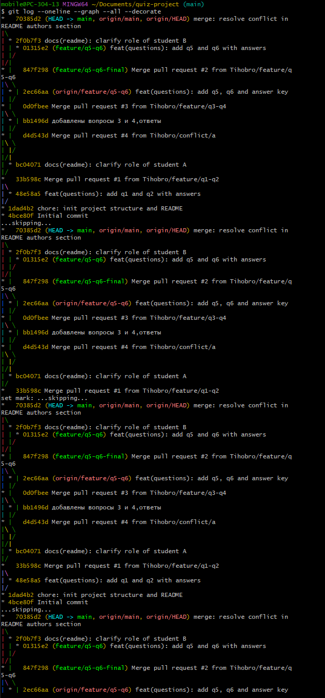
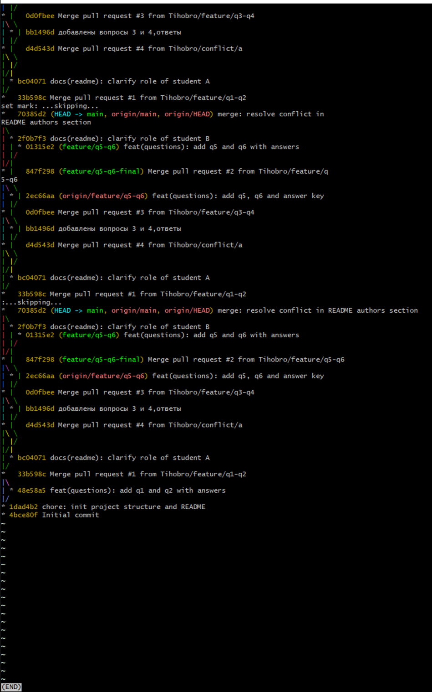
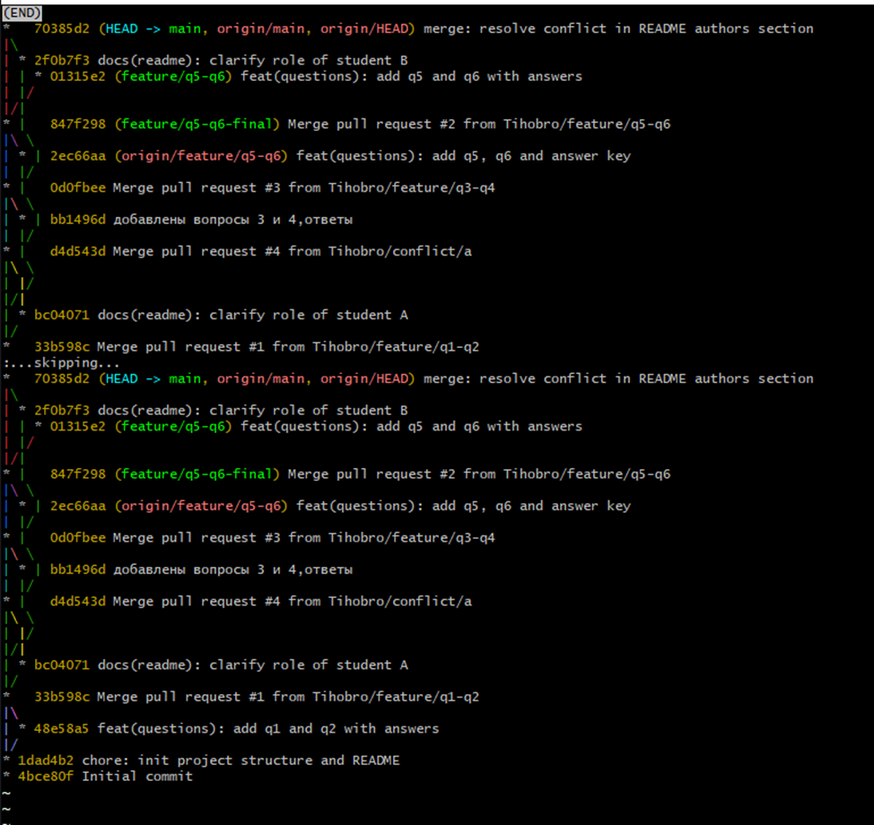
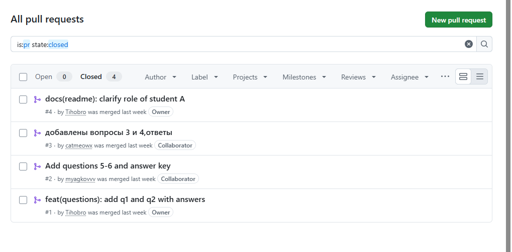

# Отчёт по практической работе «Создание теста командой из трёх студентов в Git»

## 1. Тема и цель
**Тема:** Совместная работа в распределенной системе контроля версий Git, создание Pull Request, ветвление и разрешение конфликтов слияния.
**Цель:** Приобрести практические навыки командной работы в Git и GitHub, научиться работать с ветками feature, создавать и ревьюить PR, а также разрешать конфликты вручную.

## 2. Состав команды

| Роль | ФИО | GitHub |
|------|-----|--------|
| Team Lead (Студент A) | Одинцова надежда Владиславовна | @Tihobro |
| Разработчик (Студент B) | Шелковникова Валерия Евгеньевна| @catmeowx |
| Тестировщик / QA (Студент C) | Мягков Егор Юрьевич | @myagkovvv |

## 3. Ссылка на репозиторий
https://github.com/Tihobro/quiz-project

## 4. Распределение задач
- **Студент A:** Инициализация репозитория, структура, README, вопросы 1–2, координация и слияние Pull Requests, создание ветки для конфликта.
- **Студент B:** Создание вопросов 3–4, участие в создании и ручном разрешении конфликта в README.md.
- **Студент C (Я):** Создание вопросов 5–6, создание общего файла ответов answers.txt, финальное тестирование структуры проекта, удаление временных файлов и составление итогового отчёта.

## 5. Хронология работы
1. **[09.10.2026]** — Студент А создал центральный репозиторий, настроил структуру и пригласил соавторов.
2. **[09.10.2026]** — Студенты B и C клонировали репозиторий и настроили локальное окружение.
3. **[09.10.2026]** — Параллельная разработка в ветках `feature/q1-q2`, `feature/q3-q4`, `feature/q5-q6`. Создание и успешный merge всех PR в ветку main.
4. **[16.10.2026]** — Искусственное создание конфликта в файле README.md через ветки `conflict/a` и `conflict/b`. Ручное разрешение конфликта Студентом B / A.
5. **[16.10.2026]** — Синхронизация ветки main, финальная проверка структуры, удаление заглушек `.gitkeep` и отправка отчёта (Студент C).

## 6. Использованные команды Git

| Команда | Назначение |
|---------|-----------|
| `git clone` | Клонирование удаленного репозитория на локальную машину |
| `git checkout -b` | Создание новой ветки и автоматический переход на неё |
| `git pull origin main` | Получение актуальных изменений из удаленной ветки main и слияние их с локальной |
| `git add` | Добавление измененных файлов в индекс (Staging Area) |
| `git commit -m` | Фиксация изменений (создание коммита) с описанием |
| `git push` | Отправка локальных коммитов в удаленный репозиторий на GitHub |
| `git merge` | Слияние указанной ветки с текущей веткой |
| `git log --graph` | Визуализация истории коммитов и графа ветвлений |
| `git rm` | Удаление файлов из рабочей директории и из индекса Git |

## 7. Скриншоты

1. **Граф коммитов (`git log --graph`)**:  
   
   
   

2. **Список Pull Requests на GitHub (раздел Closed)**:  
   

3. **Момент конфликта (маркеры `<<<<<<<`, `=======`, `>>>>>>>` в README)**:  
   У нас не сохранился этот момент.

4. **Успешный merge после конфликта**:  
   И этот скриншот тоже не сделали в тот момент, мы не знали что это нужно будет в отчете

## 8. Возникшие трудности и их решение
При выполнении работы возник учебный конфликт слияния на Этапе 5, так как два разработчика редактировали одну и ту же строку в файле `README.md`. Проблема была решена путем открытия файла в текстовом редакторе, удаления маркеров Git и объединения информации о ролях обоих студентов. После этого изменения были повторно проиндексированы и отправлены в main. Также болью были не выйденные чужие аккаунты гитхаба. Мы так случайно работали с 2 чужих аккаунтов.

## 9. Выводы
В ходе выполнения практической работы были освоены базовые принципы Git Flow (работа через ветки и Pull Requests). Мы научились распределять роли в команде, проводить код-ревью через интерфейс GitHub, а также успешно разрешать конфликты слияния, возникающие при одновременном редактировании файлов. И всегда надо проверять диспетчер пользователей!!!
